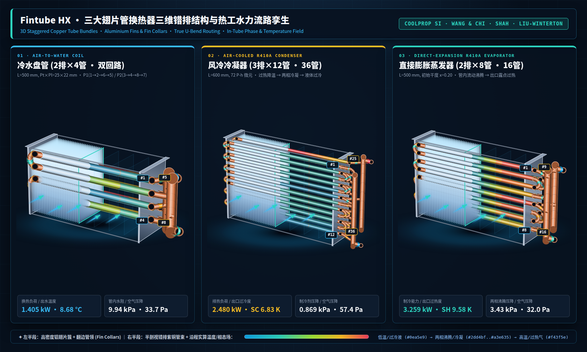

# Fintube HX Community

[ **English** | [简体中文](README.zh-CN.md) ]

[](https://github.com/wangzhichao-jpg/fintube-hx/actions/workflows/ci.yml)
[](LICENSE)
[](pyproject.toml)
[](https://youtu.be/anapOEsmAU0)
[](https://www.bilibili.com/video/BV1Y1JC6FEs9/)

**An open, reproducible Python core for baseline fin-tube heat-exchanger thermal-hydraulic calculations (MIT Licensed).**  
Supports forward rating, bounded inverse mass-flow solving, parametric scans, and CSV/Excel exports for **water coils, evaporators, and condensers**.  
Repositories: [GitHub](https://github.com/wangzhichao-jpg/fintube-hx) · [Gitee Mirror](https://gitee.com/bigtaurus/fintube-hx) | Video Overview: [YouTube (EN)](https://youtu.be/anapOEsmAU0) · [Bilibili (中文)](https://www.bilibili.com/video/BV1Y1JC6FEs9/)



## Ecosystem & Scope Overview

Fintube HX follows a three-tier architecture where Community and Pro share the same thermophysical and baseline solver core (regression-tested and reviewed in three external rounds):

| Edition | Target Audience | Key Capabilities & Scope |
|---|---|---|
| **Community (This Repo, MIT)** | Academic research, algorithm benchmarking & scripted workflows | Lumped/segmented baseline solvers, Wang & Chi (2000) plain-fin water geometry, Hausen/Gnielinski tube-side HTC, bounded inverse flow targets, CLI & JSON/CSV/XLSX I/O |
| **Pro Engineering Workbench** | HVAC&R coil design & rating engineers | Engineering unit forms, P-h/P-x state helpers, **interactive tube-by-tube circuit routing & parallel pressure balancing**, two-phase boiling/condensation correlations, multi-condition screening, Word/Excel reports |
| **Enterprise & Lab Validation** | OEMs & coil manufacturers | Physical test-rig calibration, custom fin/tube correlations, and bespoke software by the **Jianke Huanneng Technology (National Air-Conditioning Equipment Quality Inspection Center)** team |

## Implemented models

| Coil | Heat-transfer model | Geometry / pressure loss |
|---|---|---|
| Pure-water coil | **Lumped counterflow ε-NTU**; dry sensible exchange or wet-contact approximation | Input UA, or continuous plain-fin / staggered smooth-tube UA. Optional **dry air-core friction** and **water straight-tube friction** outputs |
| Evaporator | Constant-pressure P-h **counterflow axial segmentation**, uniform allocation of supplied UA | **Input UA only**; no refrigerant geometry-derived HTC or pressure loss |
| Condenser | Same input-UA P-h model, with finite enthalpy/temperature coupling in single-phase cells | **Input UA only**; no refrigerant pressure loss |

Water geometry uses Wang-Chi plain-fin j/f, Hausen/Gnielinski tube-side convection, Churchill friction and an equal-area annular-fin efficiency approximation. Wet geometry recomputes a **wet-fin efficiency proxy** from the enhanced air-side coefficient. It is not a resolved partially wet coil model. Version 0.1.0.dev8 adds an optional geometry-mode alternative, `model.wet_surface_model: "threlkeld_braun"`: Braun–Klein–Mitchell (1989) enthalpy-potential ε-NTU with the Threlkeld wet-fin efficiency (Lewis number 1, dry j applied to the wet surface, condensate-film resistance neglected); the coil is taken as the larger of the dry and fully wet heat rates. Omitting the field keeps the legacy contact approximation.

Version 0.1.0.dev9 adds two fin types to the water geometry: `geometry.fin_type: "louver"` (Wang, Lee, Chang & Lin 1999, IJHMT 42:1945; requires `louver_pitch_m`, `louver_height_m`) and `"wavy_herringbone"` (Wang, Hwang & Lin 2002, IJR 25:673; requires `wave_height_m`, `wave_projected_length_m`; fin faces use the developed area sec θ). Both are restricted to the published sample ranges and default to the Schmidt plate-fin efficiency used in the papers' data reduction (`geometry.fin_efficiency_method`, also selectable for plain fins). Both published j correlations are split at Re_Dc = 1000; for multi-row coils the two branches differ by up to tens of percent at that point (low-Re "level-off" in the data); the equations are used as published. Wet surfaces use the dry j/f. Version 0.1.0.dev10 adds `geometry.correlation_range_tolerance` (at most 0.01): an explicit, declared extension of the *geometric* sample bounds of the louver/wavy correlations (never Re or rows); every extended parameter is listed in the result and a "boundary extrapolation" warning is issued.

Version 0.1.0.dev7 adds two optional geometry items: `geometry.fin_count` (actual counted fins; changes area only, the Wang hydraulic diameter stays periodic) and `model.exposed_tubes` (unfinned straight tube ends and U-bends standing in the air stream; Churchill–Bernstein single-cylinder crossflow at a declared approach velocity, dry only, heat reported separately to a bypass stream).

Features: JSON input validation, isolated input/result snapshots, CLI single-case and batch execution, parameter scans, CSV/XLSX export, and bounded mass-flow targets for **water outlet temperature, refrigerant superheat or subcooling**. An outlet-air-temperature target is not implemented.

## Quick start

**Python 3.12 is required (`>=3.12,<3.13`). Python 3.13 is not supported by this pinned environment.** Select the interpreter explicitly rather than using the system default:

```bash
uv venv --python 3.12 .venv
uv pip install --python .venv --index-url https://pypi.tuna.tsinghua.edu.cn/simple -r requirements-development-lock.txt -e .
# Activate: source .venv/bin/activate (POSIX), .venv\Scripts\activate (Windows)
```

Alternatively, use `python3.12 -m venv .venv` (Windows: `py -3.12 -m venv .venv`), activate it and install with pip. If the mirror lacks a package, use official PyPI with TLS verification enabled.

```bash
fintube-hx capabilities
fintube-hx run examples/water_geometry.json --output output/result.json --xlsx output/result.xlsx
fintube-hx scan examples/water_dry.json --parameter air.volume_flow_m3_h --values "[800,1000,1200]" --output output/scan.json
pytest -q
```

```python
from fintube_hx.engine import run_case
from fintube_hx.storage import load_case
result = run_case(load_case("examples/water_geometry.json"))
print(result["heat_transfer_w"], result["fluid_out"]["temperature_c"])
```

## Input and output conventions

- Temperatures: °C; pressures: **absolute Pa**; dimensions: m; mass flow: kg/s; air volume flow: **actual inlet m³/h**; RH: 0–1.
- Provide either `fluid.inlet_t_c` or `fluid.inlet_h_j_kg`, not both. Two-phase inputs use **P-h**; the JSON contract has no inlet-quality field.
- `model.segments` controls refrigerant axial cells only. Water is lumped: the field may be omitted; legacy supplied values do not subdivide the coil and are reported as **not applied** in `numerical_controls`.
- Inverse flow bounds must bracket the desired root. Same-sign endpoints do not prove that an internal root is absent; the solver does not certify monotonicity or global uniqueness.
- Water pressure outputs are scoped **straight-tube/core friction**, not total installed-coil or system losses. Return bends, headers, inlet/outlet contraction/expansion and wet-film losses are not included.

## Current engineering scope

The water wet/dry policy uses inlet water temperature and a contact approximation, not local wall temperature or partially wet area. Air properties are inlet-based; water properties use an iterated mean temperature. Wang uses the fin-collar diameter, not the bare-tube OD. For the equal-thickness collar convention this is Dc = OD + 2×fin thickness; actual formed collar dimensions are not independently specified in this baseline. The default fin count is L/fin pitch; `fin_count` supplies the actual count. The outer-edge geometry is idealized.

There are no actual tube-route networks, row-by-row crossflow, intermediate split/merge junctions, brine properties, louver/wavy fins, enhanced tubes, fouling/contact resistances, or frost model. Evaporation at/below 0°C is rejected. Correlation range checks reject extrapolation rather than silently clipping geometry.

## Measured validation (six published points)

[`validation/measured-v6/`](validation/measured-v6/README.md) is the current measured validation set: the CETIAT louver coil (20 points, R410A/R32, condensation and evaporation; capacity 20/20 within ±5 %, evaporator superheat 11/12 within ±3 K, condenser subcooling 2/8 within ±2 K), Tan 2015 wet fan-coil units (55 open-core lumped / 62 Professional tube-network units) and a plain-fin air-side cross-check; the Tan lumped results reproduce bit-for-bit with `tools/run_measured_v6_tan.py`. The earlier set [`validation/measured/`](validation/measured/README.md) (historical) lists two plain-fin water-coil points from Altwieb et al. (Energies 2022, doi:10.3390/en15020400) and four R410A evaporation/condensation points from CETIAT (IEA HPT Annex 54 2021 report, Ch. 4; ICR 2019, doi:10.18462/iir.icr.2019.1439) — two specimens in total. It gives page/table/figure locators, SHA-256 of the retrieved PDFs, mapping assumptions, all results and an acceptance assessment. Nothing is fitted to the measurements.

| Case | Measured | This repo (lumped) | Pro tube network | Verdict |
|---|---:|---:|---:|---|
| W1 water coil | 333.5 W | −7.3 % | −7.6 % | consistent (boundary-incomplete reference) |
| W2 water coil | 523.1 W | −15.8 % | −15.8 % | not met, open |
| E1 evaporator | 12.20 kW | — | −0.3 %, SH −1.4 K | consistent (capacity fixed by boundary data) |
| E2 evaporator | 14.30 kW | — | −1.5 %, SH −4.3 K | superheat not met |
| C1 condenser | 13.31 kW | — | −6.1 %, SC −6.0 K | subcooling not met |
| C2 condenser | 15.29 kW | — | −7.2 %, SC −6.6 K | subcooling not met |

The refrigerant points need a tube-circuit model that is not in this repository; Pro results are recorded for scrutiny. `python tools/run_measured_validation.py` re-runs the water points.

## Reproducible comparisons

[`references/python-hvac/`](references/python-hvac/README.md) contains a pinned source reproduction and a mapped water case. The mapped case produces **4363.49 W**, versus **4084.46 W** in the reproduced reference (+6.83%); this is a **software comparison with differing geometry/model definitions**, not a measured accuracy result or a fitted calibration.

Version **0.1.0.dev14** adds `subzero_evaporation: "initial_frost"` support in the wet-surface element (clean-surface onset of frosting: deposit as ice with its fusion enthalpy, piecewise saturation curve at 0 °C; no frost thickness, frost resistance or blockage). The lumped contact-factor refrigerant model rejects it; it is intended for strict wet-surface tube networks. Version **0.1.0.dev13** adds optional `geometry.contact_conductance_w_m2_k` (fin-collar/tube contact conductance on the tube outer area π·Do·L) and `geometry.inner_fouling_resistance_m2_k_w`, both constant series resistances with no default value; nothing changes when they are absent. Version **0.1.0.dev12** adds the optional `model.subzero_evaporation: "dry_only"` for evaporators: surfaces at or below 0 °C are accepted only while they stay at or above the local air frost point (CoolProp humid-air saturation is over ice below 0 °C), i.e. without deposition; otherwise the case is rejected because a frost model would be required. The refrigerant temperature represents the surface in this check, which is conservative. The default (`reject`) is unchanged. Version **0.1.0.dev11** adds `geometry.tube_type: "microfin"` with module `fintube_hx.microfin`: TN 2224 micro-fin geometry (Kedzierski & Lin 2023, NIST), their convective-boiling Nusselt correlation with the mixture glide factor, and the NISTIR 6333 two-phase pressure drop (Choi, Kedzierski & Domanski 1999). Geometric parameters outside the TN 2224 database raise. In this core the lumped water model rejects micro-fin tubes explicitly; the correlations are available to extensions (the Professional evaporator network uses them). They are implementation-verified against the published example and geometry, not yet validated against measured coils. Version **0.1.0.dev10** adds the declared `correlation_range_tolerance`; without it nothing changes. Version **0.1.0.dev9** adds louver and herringbone-wavy fins and the Schmidt fin efficiency (module `fintube_hx.airside`); plain-fin cases without `fin_efficiency_method` are bit-for-bit unchanged. Version **0.1.0.dev8** adds the optional `wet_surface_model` (module `fintube_hx.wet_surface`); without it all existing results are bit-for-bit unchanged. Version **0.1.0.dev7** adds `fin_count`, `exposed_tubes` and the measured-validation set; without these fields all existing results are bit-for-bit unchanged.

For lumped refrigerant models, an omitted `solver.max_iterations` defaults to `max(200, 2*segments + 20)`. An explicit limit is never increased; a low budget is disclosed and an unconverged run still exits with code 2. Version **0.1.0.dev6** adds this budget correction; it does not change heat-transfer equations.

The status of every review item (fixed / clarified / open) is tracked in [docs/EXTERNAL_REVIEW_STATUS.md](docs/EXTERNAL_REVIEW_STATUS.md). The [v3 follow-up](docs/EXTERNAL_REVIEW_V3.md) records the controlled wet-branch diagnostic and corrected current-version status. The [external review response](docs/EXTERNAL_REVIEW_2026-10-13.md) records confirmed issues, corrections and reasons for disputed claims. Version **0.1.0.dev5** corrects fin blockage in the diagonal minimum-flow gap and the misleading inverse-bracket error message; existing transverse-gap reference capacities are unchanged.

## License

Original code: [MIT](LICENSE). Dependencies and adapted python-hvac expressions have separate licences and attribution; see [THIRD_PARTY_NOTICES.md](THIRD_PARTY_NOTICES.md), [CORE_API.md](CORE_API.md) and [CONTRIBUTING.md](CONTRIBUTING.md).
